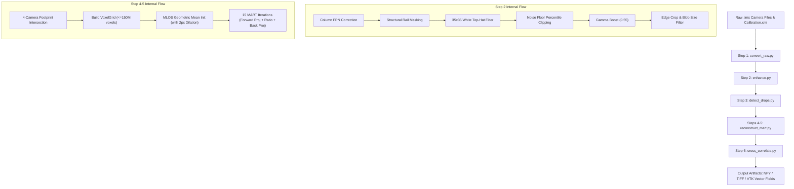

# Technical Architecture, Execution Flow & Interview Defense Guide: Tomo-PIV Pipeline

---

## 1. High-Level Overview & Architecture

### Elevator Pitch
> **A high-performance, GPU-accelerated 3D Tomographic Particle Image Velocimetry (Tomo-PIV) pipeline in Python that processes multi-camera raw optical frames to reconstruct 3D tracer particle volumetric density fields using Multiplicative Algebraic Reconstruction Technique (MART) with MLOS initialization, and computes 3D velocity vector fields via 3D multigrid FFT cross-correlation.**

---

### Core Tech Stack & Frameworks

| Layer / Domain | Technologies Used | Role / Purpose |
| :--- | :--- | :--- |
| **Language & Runtime** | Python 3.10+ | Core language for script orchestration and numerical processing. |
| **Array Compute & GPU Acceleration** | `NumPy`, `CuPy` (`cupyx.scatter_add`) | Vectorized math; CuPy provides transparent GPU CUDA acceleration with fallback to NumPy CPU. |
| **Computer Vision & Calibration** | OpenCV (`cv2`) | Pinhole camera geometry (`cv2.projectPoints`, `cv2.undistortPoints`, `cv2.Rodrigues`), morphological top-hat filtering, connected components. |
| **Signal Processing & Detection** | `scikit-image` (`skimage.feature.peak_local_max`, `skimage.filters.difference_of_gaussians`) | Difference-of-Gaussians (DoG) particle isolation and 2D local peak detection. |
| **File I/O & Formats** | Pillow (`PIL`), `tifffile`, `struct`, `xml.etree.ElementTree` | Parsing custom 12-bit LaVision DaVis `.ims` raw buffers, TIFF 3D stacks, XML calibration/metadata, JPEG previews. |
| **Vector Field Export & 3D Visualization** | `paraview.simple`, `vtkmodules`, CSV, JSON | PolyData ASCII VTK export (`.vtk`), VTU time-series animation collection (`.pvd`), structural visualization in ParaView. |

---

### Key Architectural Design Patterns Used

1. **Pipeline / Filter Pattern**: The system is organized into discrete, independently executable sequential stages (Steps 1 through 6). Each step reads output artifacts from disk left by the prior step without mutating original raw inputs.
2. **Strategy / Hardware Abstraction Pattern** ([`gpu_utils.py`](server/pipeline/gpu_utils.py)): Exposes a unified array interface (`get_xp`) returning CuPy or NumPy dynamically based on CUDA GPU availability.
3. **Data Transfer Object (DTO) / Frozen Dataclasses**: High-integrity immutable objects ([`RunLayout`](server/pipeline/project_layout.py#L220), [`VoxelGrid`](server/pipeline/voxel_grid.py#L40), [`PinholeCamera`](server/pipeline/calibration.py#L38), [`VectorSample`](server/pipeline/cross_correlate.py#L91), [`FrameRef`](server/pipeline/ims_io.py#L39)) guarantee consistent grid parameters and coordinate transformations across pipeline execution.
4. **Multigrid / Coarse-to-Fine Pattern** ([`cross_correlate.py`](server/pipeline/cross_correlate.py#L155)): Two-pass interrogation window correlation; coarse pass captures gross bulk flow, fine pass uses coarse vectors as predictors to resolve fine local velocity gradients.

---

### Directory Structure & Module Responsibilities

```
<repo>\
├── pipeline/                      # Core Tomo-PIV package directory
│   ├── __init__.py                # Package initialization
│   ├── project_layout.py          # Central path configuration, ROI bounds, & processing hyperparameters
│   ├── ims_io.py                  # Binary LaVision .ims reader/writer (Mono12p MSB & Raw8 decoders)
│   ├── calibration.py             # DaVis Calibration.xml pinhole camera model parser & ray caster
│   ├── voxel_grid.py              # Automated 3D physical ROI estimation & VoxelGrid builder
│   ├── gpu_utils.py               # CuPy GPU vs NumPy CPU transparent execution backend helper
│   ├── convert_raw.py             # [Step 1] Decodes raw binary .ims camera frames to linear 8-bit JPEGs
│   ├── enhance.py                 # [Step 2] FPN subtraction, rail masking, top-hat, noise floor, crop & blob filter
│   ├── detect_drops.py            # [Step 3] Difference-of-Gaussians & local peak centroid detector (CSV/JPEG)
│   ├── mart.py                    # [Mathematical Engine] MLOS volume initialization & MART reconstruction loop
│   ├── reconstruct_mart.py        # [Steps 4-5] Volumetric grid generator & MART reconstructor (NPY/TIFF/MIP)
│   ├── cross_correlate.py         # [Step 6] 3D FFT cross-correlation, Gaussian sub-voxel fit & UOD outlier filter
│   ├── run_pipeline.py            # [CLI Entrypoint] End-to-end CLI orchestrator executing Steps 1 to 5
│   ├── export_vtu_series.py       # ParaView script exporting volume series to VTU XML format
│   └── load_volume_animation.py   # ParaView Python script for time-series volumetric rendering
└── output/                        # Output data root (auto-created per run)
    └── <run_name>/
        ├── converted_jpg/         # Step 1 linear JPEG previews
        ├── filtered/              # Step 2 enhanced 12-bit .ims + JPEG images
        ├── drop/                  # Step 3 detected droplet centroid CSVs + annotated JPEGs
        └── volumes/               # Steps 4-6 3D voxel grids (.npy/.tif/.json) & velocity vectors (.csv/.vtk)
```

---

## 2. Execution Flow (Entrypoint to Output)

### Main Entrypoint
The primary execution entrypoint is [`run_pipeline.py`](server/pipeline/run_pipeline.py), executed via CLI:
```bash
python -m pipeline.run_pipeline --run "LI_16072026_7.2mm_09" --iterations 15
```

---

### Sequential End-to-End Execution Flow



#### Step-by-Step Data Transformations

1. **CLI Launch & Path Initialization** ([`run_pipeline.py:main`](server/pipeline/run_pipeline.py#L30)):
   - Configures logging format and calls [`get_run_layout(run_name)`](server/pipeline/project_layout.py#L235) to set up output directories (`converted_jpg/`, `filtered/`, `drop/`, `volumes/`).

2. **Step 1: Raw Image Decoding** ([`convert_raw.py:run_step1`](server/pipeline/convert_raw.py#L20)):
   - Parses resolution from header `FrameN-0.ims` and decoder format from `FrameN-decoder.xml`.
   - Loads binary buffer from `FrameN-1.ims` using [`load_ims_image`](server/pipeline/ims_io.py#L149). Unpacks 12-bit packed bytes into uint16 arrays $(0..4095)$.
   - Converts to linear 8-bit uint8 arrays ($img8 = img12 \times 255 / 4095$) and saves straight JPEGs for visual inspection.

3. **Step 2: Optical Signal Enhancement & Artefact Suppression** ([`enhance.py:run_step2`](server/pipeline/enhance.py#L168)):
   - **Column Fixed-Pattern Noise (FPN) Correction**: Subtracts column-wise medians and adds global median ([`correct_column_fpn`](server/pipeline/enhance.py#L59)).
   - **Structural Rail Masking**: Zeroes columns lit $>8\%$ over image height ([`structural_column_mask`](server/pipeline/enhance.py#L70)) to eliminate bright metal reflections.
   - **Morphological Top-Hat**: $35 \times 35$ ellipse structuring element removes non-uniform background illumination.
   - **Noise Floor Subtraction**: Clips pixels below `NOISE_FLOOR_PERCENTILE` (e.g. 99.3th percentile) to 0.
   - **Gamma Boost**: Normalizes signal and applies $\gamma = 0.55$ contrast curve to brighten dim seeding droplets.
   - **Edge Crop & Oversized Blob Removal**: Applies zero-padding margins and removes blobs larger than `MAX_PARTICLE_PX` via connected component labeling ([`remove_oversized_blobs`](server/pipeline/enhance.py#L111)) to prevent ghost ray smearing.
   - Saves filtered 12-bit `.ims` and preview JPEGs.

4. **Step 3: 2D Particle Centroid Detection** ([`detect_drops.py:run_step3`](server/pipeline/detect_drops.py#L60)):
   - Applies Difference-of-Gaussians (DoG, $\sigma_1=1.0, \sigma_2=6.0$) to isolate particle-scale blob features.
   - Calculates robust dynamic threshold: $T = \text{median} + 3.0 \times 1.4826 \times \text{MAD}$.
   - Extracts local maxima coordinates using [`peak_local_max`](server/pipeline/detect_drops.py#L43).
   - Writes `(row_px, col_px)` centroid CSV files and red-annotated JPEG previews.

5. **Steps 4 & 5: MART 3D Volumetric Reconstruction** ([`reconstruct_mart.py:run_steps_4_5`](server/pipeline/reconstruct_mart.py#L188)):
   - Loads pinhole calibration parameters via [`parse_calibration`](server/pipeline/calibration.py#L90) scaled to exact image dimensions.
   - Computes physical $(X, Y)$ world bounds by back-projecting detection bounding boxes across $Z$-planes ($Z \in [-6, +6]\text{ mm}$) and taking the 4-camera **intersection** ([`estimate_world_xy_bounds`](server/pipeline/voxel_grid.py#L79)).
   - Builds isotropic [`VoxelGrid`](server/pipeline/voxel_grid.py#L40) dynamically auto-scaled to stay under 150M voxels.
   - Computes **MLOS Initial Volume** ([`compute_mlos_initial_volume`](server/pipeline/mart.py#L169)) using geometric mean of 4 camera projections with 2px grey dilation tolerance.
   - Runs 15 MART iterations ([`run_mart`](server/pipeline/mart.py#L221)): Forward projection $\rightarrow$ Intensity ratio calculation $\rightarrow$ Multiplicative back-projection update.
   - Saves 3D volume numpy array (`volume_*.npy`), 3D TIFF stack (`volume_*.tif`), and Maximum Intensity Projection (`_MIP.jpg`).

6. **Step 6: 3D Multigrid Cross-Correlation & Vector Field Generation** ([`cross_correlate.py:run_step6`](server/pipeline/cross_correlate.py#L524)):
   - Loads Volume A ($t_1$) and Volume B ($t_2$).
   - **Coarse Pass**: Subdivides volumes into $32 \times 32 \times 32$ interrogation windows and evaluates 3D FFT cross-correlation ($R = \mathcal{F}^{-1}(\mathcal{F}(A)^* \cdot \mathcal{F}(B))$).
   - **Fine Pass**: Pre-shifts fine interrogation windows ($128 \times 128$ or smaller) by nearest coarse displacement vector ([`_make_offset_lookup`](server/pipeline/cross_correlate.py#L216)).
   - Fits 3-point 1D Gaussian curve ([`_gaussian_subpixel_1d`](server/pipeline/cross_correlate.py#L102)) for sub-voxel displacement accuracy ($0.05..0.1\text{ voxels}$).
   - Validates vectors using Keane & Adrian peak-ratio ($>1.2$), edge boundaries, and Universal Outlier Detection ([`_universal_outlier_detection`](server/pipeline/cross_correlate.py#L251)).
   - Computes physical velocity components ($u, v, w\text{ in m/s}$) using $\Delta t$. Writes `vector_*.csv`, ASCII `vector_*.vtk` (with cell vertices topology), and `vector_*_summary.json`.

---

## 3. Deep Dive into Key Functions & Classes

### 1. `ims_io.py`: `decode_mono12p_msb`
- **File & Function**: [`server/pipeline/ims_io.py`](server/pipeline/ims_io.py#L81) `decode_mono12p_msb(raw: np.ndarray, width: int, height: int) -> np.ndarray`
- **Purpose**: Decodes headerless binary buffer of 12-bit pixel data packed 2 pixels into 3 bytes (MSB-first) into a 2D uint16 image array.
- **Inputs**: `raw` (`np.ndarray` of uint8, length = $\text{width} \times \text{height} \times 1.5$), `width` (`int`), `height` (`int`).
- **Outputs**: 2D uint16 `np.ndarray` of shape `(height, width)` with intensity values $0..4095$.
- **Step-by-Step Logic**:
  1. Validates byte buffer length against expected size ($\text{width} \times \text{height} \times 3 / 2$).
  2. Reshapes byte stream into $(-1, 3)$ triplets ($B_0, B_1, B_2$).
  3. Extracts packed 12-bit integers via bitwise shifts and masks:
     $$P_0 = (B_0 \ll 4) \mid (B_1 \ \& \ 0\text{x0F})$$
     $$P_1 = (B_2 \ll 4) \mid (B_1 \gg 4)$$
  4. Interleaves $P_0$ and $P_1$ into an even-indexed output array and reshapes to `(height, width)`.
- **Edge Cases & Error Handling**: Raises `ValueError` if raw buffer size doesn't match expected dimensions.

---

### 2. `calibration.py`: `PinholeCamera` & `parse_calibration`
- **File & Class/Function**: [`server/pipeline/calibration.py`](server/pipeline/calibration.py#L38) `PinholeCamera`, `parse_calibration(...)`
- **Purpose**: Parses DaVis XML calibration parameters and implements forward 3D world $\rightarrow$ 2D pixel projection and back-projection ray casting.
- **Inputs**: `xml_path` (`Path`), `image_width` (`int`), `image_height` (`int`).
- **Outputs**: Dictionary mapping camera ID (`int`) to initialized [`PinholeCamera`](server/pipeline/calibration.py#L38) instance.
- **Step-by-Step Logic**:
  1. Reads `<OriginalImageSize>` and `<Transformations BinningX/Y>` from XML.
  2. Computes resolution scale factors: $s_x = \text{image\_width} / \text{orig\_w}$, $s_y = \text{image\_height} / \text{orig\_h}$.
  3. Scales camera matrix focal lengths ($f_x, f_y$) and principal points ($c_x, c_y$) proportionally by $s_x, s_y$ and binning pitch:
     $$f_x = \frac{\text{FocalLengthPixel}_x}{\text{SensorPixelSize} \times \text{BinningX}} \times s_x$$
  4. Extracts radial ($k_1, k_2$) and tangential ($p_1, p_2$) distortion coefficients, translation vector $T$, and rotation vector $R$ (via `cv2.Rodrigues`).
  5. Computes camera world position: $C_{\text{world}} = -R^T T$.
- **Critical Requirement**: Failure to scale intrinsic parameters to match the actual loaded image resolution causes back-projected rays to miss by $2\times$ pixel distance, resulting in zero 4-camera coincidences and empty 3D volumes.

---

### 3. `enhance.py`: `enhance_image` & `remove_oversized_blobs`
- **File & Functions**: [`server/pipeline/enhance.py`](server/pipeline/enhance.py#L141) `enhance_image`, `remove_oversized_blobs`
- **Purpose**: Enhances optical contrast of small tracer droplets while stripping away background FPN, structural metal rail reflections, and oversized saturated light blobs.
- **Inputs**: `img12` (2D uint16 array, $0..4095$).
- **Outputs**: Enhanced 2D uint16 array ($0..4095$).
- **Step-by-Step Logic**:
  1. Runs [`correct_column_fpn`](server/pipeline/enhance.py#L59) to flatten vertical sensor column offset stripes.
  2. Identifies persistent bright columns ($>8\%$ height) via [`structural_column_mask`](server/pipeline/enhance.py#L70) and zeroes them.
  3. Executes morphological Top-Hat filter ($35 \times 35$ ellipse) to remove non-uniform laser background glow.
  4. Computes percentile noise floor (e.g. 99.3th percentile) and clips background to 0.
  5. Normalizes non-zero signal and applies Gamma exponent ($\gamma = 0.55$) to boost faint particles.
  6. Applies [`remove_oversized_blobs`](server/pipeline/enhance.py#L111): labels connected components (`cv2.connectedComponentsWithStats`) and zeroes bright regions with width or height exceeding `MAX_PARTICLE_PX`.
- **Why Blob Size Suppression Matters**: Reconstructed $Z$-extent of a blob correlates with its 2D image size ($r = 0.93$). A 2px droplet stays compact ($\sim 0.2\text{mm}$ deep), whereas a 14px reflection smears across the full $4\text{mm}$ depth volume as a continuous "ghost ray".

---

### 4. `voxel_grid.py`: `estimate_world_xy_bounds`
- **File & Function**: [`server/pipeline/voxel_grid.py`](server/pipeline/voxel_grid.py#L79) `estimate_world_xy_bounds`
- **Purpose**: Derives conservative physical $(X, Y)$ world space bounds for the 3D reconstruction volume based on multi-camera droplet detections.
- **Inputs**: `cameras` (`dict[int, PinholeCamera]`), `detection_csvs` (`list[Path]`), `z_min` (`float`), `z_max` (`float`).
- **Outputs**: Tuple `(x_min, x_max, y_min, y_max)` in physical millimeters.
- **Step-by-Step Logic**:
  1. For each camera, loads detected droplet $(row, col)$ centroids.
  2. Computes robust 5th and 95th percentile bounding boxes (trims edge outlier noise).
  3. Back-projects corner pixel rays across 5 evaluation $Z$-planes ($Z \in [Z_{\text{min}}, Z_{\text{max}}]$) using pinhole camera ray casting.
  4. Computes the **INTERSECTION** of per-camera bounding boxes:
     $$x_{\text{min}} = \max(x_{\text{min}}^{\text{cam1}}, x_{\text{min}}^{\text{cam2}}, ...), \quad x_{\text{max}} = \min(x_{\text{max}}^{\text{cam1}}, x_{\text{max}}^{\text{cam2}}, ...)$$
  5. Adds an $8\%$ safety margin padding.
- **Key Insight**: Taking the intersection rather than the union reduces volume dimensions by $\sim 60\%$, saving GPU memory while guaranteeing the ROI covers the 4-camera coincidence zone.

---

### 5. `mart.py`: `compute_mlos_initial_volume` & `run_mart`
- **File & Functions**: [`server/pipeline/mart.py`](server/pipeline/mart.py#L169) `compute_mlos_initial_volume`, `run_mart`
- **Purpose**: Implements Multiplicative Line-of-Sight (MLOS) initialization and MART iterative 3D reconstruction.
- **Inputs**: `cameras`, 4 normalized 2D camera images, `grid` (`VoxelGrid`), compute module `xp` (`cupy` or `numpy`), `n_iterations` (`int=15`).
- **Outputs**: 3D float32 voxel array of shape `(nz, ny, nx)`.
- **Step-by-Step Logic**:
  1. **MLOS Initialization**:
     - Dilates input images by `MLOS_TOLERANCE_PX` (2px grey dilation) to handle sub-pixel calibration errors.
     - Projects world $(X, Y)$ voxel grid coordinates for each $Z$-slice into all 4 camera planes using bilinear gathering ([`bilinear_gather`](server/pipeline/mart.py#L83)).
     - Computes voxel initial intensity as the **geometric mean** of all 4 projected intensities:
       $$E_0(X,Y,Z) = \left( \prod_{c=1}^{4} I_c(\text{proj}_c(X,Y,Z)) \right)^{1/4}$$
     - Scales initial volume so forward projection matches measured image intensity.
  2. **MART Iteration Loop** (for iteration 1 to $N$):
     - For each camera $c$:
       - Forward-projects current 3D volume onto 2D image plane via bilinear scatter-add ([`bilinear_scatter_add`](server/pipeline/mart.py#L100), utilizing `cupyx.scatter_add` on GPU).
       - Computes correction ratio:
         $$R_c(u,v) = \text{clip}\left( \frac{I_c(u,v)}{\hat{I}_c(u,v)}, 0.2, 5.0 \right)$$
       - Back-projects ratio to 3D voxel grid and updates volume multiplicatively:
         $$E_{k+1}(X,Y,Z) = E_k(X,Y,Z) \times \left( R_c(\text{proj}_c(X,Y,Z)) \right)^{\mu}$$

---

### 6. `cross_correlate.py`: `run_cross_correlation` & `_universal_outlier_detection`
- **File & Functions**: [`server/pipeline/cross_correlate.py`](server/pipeline/cross_correlate.py#L366) `run_cross_correlation`, `_universal_outlier_detection`
- **Purpose**: Computes 3D multigrid cross-correlation velocity fields between Volume A ($t_1$) and Volume B ($t_2$).
- **Inputs**: Volume A and B 3D arrays, `window_xy`, `window_z`, `dt_us`.
- **Outputs**: List of [`VectorSample`](server/pipeline/cross_correlate.py#L91) objects containing 3D position $(X,Y,Z)$, physical displacements $(dx, dy, dz)$, velocity components $(u, v, w)$, peak ratio, and validation status.
- **Step-by-Step Logic**:
  1. **Coarse Pass**: Computes 3D FFT cross-correlation on $32 \times 32 \times 32$ windows:
     $$R = \mathcal{F}^{-1}\left( \mathcal{F}(A)^* \cdot \mathcal{F}(B) \right)$$
  2. **Fine Pass**: Pre-shifts fine interrogation windows ($128 \times 128$ or smaller) by nearest coarse displacement vector ([`_make_offset_lookup`](server/pipeline/cross_correlate.py#L216)).
  3. **Sub-Voxel Gaussian Fitting**: Fits 3-point 1D Gaussian curve along $X, Y, Z$ axes ([`_gaussian_subpixel_1d`](server/pipeline/cross_correlate.py#L102)):
     $$\Delta = \frac{0.5 \left( \ln R_{-1} - \ln R_{+1} \right)}{\ln R_{-1} - 2\ln R_0 + \ln R_{+1}}$$
  4. **Universal Outlier Detection (UOD)** ([`_universal_outlier_detection`](server/pipeline/cross_correlate.py#L251)): Evaluates each vector against its 26 immediate 3D grid neighbours (Westerweel & Scarano 2005). Computes neighbour median and Median Absolute Deviation (MAD). Flags vectors where:
     $$\frac{|v_i - \text{median}|}{\text{MAD} + \epsilon} > 2.0$$

---

## 4. Interview Defense & Technical Discussion

### Top 3 Architectural & Design Decisions

#### 1. MLOS (Multiplicative Line-of-Sight) Initialization vs. Uniform Initialization
- **Decision**: Initialize the 3D voxel grid with the geometric mean of 4-camera projected intensities ([`compute_mlos_initial_volume`](server/pipeline/mart.py#L169)) rather than a uniform constant.
- **Trade-off**:
  - *Pros*: Eliminates ghost rays before iteration starts. Cuts required MART iterations from $50+$ down to $12-15$, speeding up reconstruction by $>3\times$.
  - *Cons*: Highly sensitive to camera calibration accuracy. A sub-pixel calibration error can cause MLOS to zero out real particles. Solved by incorporating a 2px spatial grey dilation tolerance ([`_dilate_2d`](server/pipeline/mart.py#L155)).

#### 2. Footprint Intersection for Voxel Grid ROI Bounds
- **Decision**: Define physical $(X, Y)$ world reconstruction bounds using the **intersection** of back-projected 4-camera detection bounding boxes ([`estimate_world_xy_bounds`](server/pipeline/voxel_grid.py#L79)).
- **Trade-off**:
  - *Pros*: Reduces total voxel count by $\sim 60\%$, keeping memory well below GPU limits ($\le 150\text{M}$ voxels) and avoiding computation in regions where 4-camera coincidence is physically impossible.
  - *Cons*: Any true particles flowing outside the 4-camera overlap region are cropped out of the reconstruction.

#### 3. Two-Pass Multigrid Iterative Window-Offset Cross-Correlation
- **Decision**: Perform a two-pass cross-correlation scheme where a coarse pass predicts bulk displacement and a fine pass resolves local residual motion ([`_correlate_pass`](server/pipeline/cross_correlate.py#L155)).
- **Trade-off**:
  - *Pros*: Captures large bulk displacements without requiring huge fine windows, simultaneously maximizing spatial resolution and Signal-to-Noise Ratio (SNR).
  - *Cons*: Adds algorithmic complexity (requiring 3D spatial lookup predictors) and increases execution time compared to a single-pass correlation.

---

### 5 Likely Technical Interview Questions & Answers

#### Q1: How does your pipeline suppress ghost ray artifacts in 3D Tomo-PIV?
> **Candidate Answer**:
> "Ghost rays stem from lines of sight where single-camera projections overlap ambiguous background space due to narrow camera apertures (~12.6 degrees). We address this at three levels:
> 1. **MLOS Initialization** ([`mart.py`](server/pipeline/mart.py)): Multiplicative seeding zeros out any voxel where even a single camera sees no intensity.
> 2. **Blob Size Filtering** ([`enhance.py`](server/pipeline/enhance.py#L111)): Connected component analysis removes 2D blobs $>8\text{px}$. Reconstructed $Z$-depth correlates with 2D blob size ($r = 0.93$), so large blobs smear across the full $4\text{mm}$ depth as ghost rays.
> 3. **Percentile Noise Floor Clipping** ([`enhance.py`](server/pipeline/enhance.py#L150)): Clipping the bottom $99.3\%$ of top-hat filtered intensities forces background pixels strictly to zero."

#### Q2: How did you implement hardware acceleration and handle systems without GPUs?
> **Candidate Answer**:
> "We built a hardware abstraction module in [`gpu_utils.py`](server/pipeline/gpu_utils.py) that exposes a unified array interface `get_xp()`. It dynamically checks for `cupy` and validates CUDA execution. If available, heavy volumetric operations (such as bilinear scatter-add via `cupyx.scatter_add`) run on the GPU. If CUDA is unavailable or fails, it falls back transparently to NumPy (`np.add.at`), ensuring complete cross-platform portability without code duplication."

#### Q3: Why is camera calibration resolution handling critical, and how is it implemented?
> **Candidate Answer**:
> "The pinhole camera model in DaVis `Calibration.xml` is fit at a specific reference resolution and binning factor (e.g. $1216 \times 1024$, 2x2 binned). When processing unbinned data ($2448 \times 2048$), intrinsic parameters ($f_x, f_y, c_x, c_y$) must be scaled proportionally ([`calibration.py:parse_calibration`](server/pipeline/calibration.py#L90)). If unscaled, back-projected pixel rays miss real physical locations by $2\times$, causing 4-camera coincidences to fail and producing empty volumes. Normalized distortion parameters ($k_1, k_2, p_1, p_2$) and extrinsic rotation/translation vectors ($R, T$) remain resolution-invariant."

#### Q4: Explain the Universal Outlier Detection (UOD) algorithm used in Step 6.
> **Candidate Answer**:
> "Fixed velocity thresholding fails in spatially non-uniform or turbulent flows. In [`cross_correlate.py`](server/pipeline/cross_correlate.py#L251), we implement Westerweel & Scarano's (2005) Universal Outlier Detection. For each 3D vector, we inspect its 26 immediate 3D grid neighbours, computing their median displacement and Median Absolute Deviation (MAD). We normalize the center vector's residual by $(\text{MAD} + \epsilon)$. If the normalized residual exceeds $2.0$, it is flagged invalid. This provides a robust, locally adaptive outlier test regardless of local flow velocity magnitude."

#### Q5: How do you achieve sub-voxel displacement accuracy in 3D cross-correlation?
> **Candidate Answer**:
> "Standard 3D FFT cross-correlation returns discrete integer voxel peak locations. To refine displacement to sub-voxel accuracy ($0.05..0.1\text{ voxels}$ precision), we fit a 3-point 1D Gaussian curve independently along the $X, Y,$ and $Z$ axes ([`cross_correlate.py:_gaussian_subpixel_1d`](server/pipeline/cross_correlate.py#L102)) using the peak correlation value and its immediate left/right neighbours:
> $$\Delta = \frac{0.5 \left( \ln R_{-1} - \ln R_{+1} \right)}{\ln R_{-1} - 2\ln R_0 + \ln R_{+1}}$$
> This sub-voxel offset is added to the integer grid peak location."

---

### Potential Bottlenecks & Refactoring Improvements

If asked *"How would you improve this codebase?"*, highlight these 3 engineering enhancements:

1. **Custom CUDA C++/Numba Kernel for Volumetric Projection**:
   - *Current Bottleneck*: Slice-by-slice $(Z)$ looping in Python calling `cupyx.scatter_add`.
   - *Proposed Improvement*: Write a dedicated CUDA C++ kernel (or Numba `@cuda.jit`) to project the entire 3D volume in parallel across GPU threadblocks. This eliminates Python slice loop overhead and reduces memory allocations.

2. **Multiprocessing / Async Pipeline Parallelism**:
   - *Current Bottleneck*: Sequential frame-by-frame processing in Steps 1, 2, and 3.
   - *Proposed Improvement*: Use `concurrent.futures.ProcessPoolExecutor` to parallelize raw conversion, enhancement, and droplet detection across CPU cores for multi-frame burst acquisitions.

3. **Pydantic / Structured Configuration Architecture**:
   - *Current Bottleneck*: Global configuration parameters mutated directly in [`project_layout.py`](server/pipeline/project_layout.py).
   - *Proposed Improvement*: Transition to structured Pydantic/YAML configuration models with strict CLI overrides and experiment versioning, improving maintainability and reproducibility.
